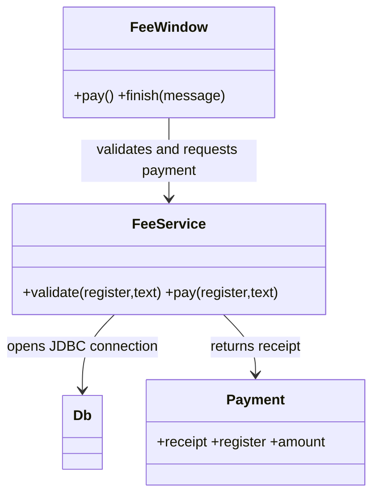

# Q1 Fee payment design review

## Aim and diagnosis
Repair the fee window by separating collection/display, validation/payment and database work.

| Deficiency | User impact / failure |
|---|---|
| GUI contains payment and persistence logic | Hard to test without a real window and database; unrelated changes affect one handler |
| `==` compares command references | A command with identical text can miss the Pay branch |
| Unvalidated empty/nonnumeric/negative amount | Exceptions or invalid fee values; NaN/infinity accepted by bare double parsing |
| JDBC on the event-dispatch thread | Window cannot repaint or process input while the query runs |
| `Thread.sleep(3000)` on that thread | Three-second artificial freeze, without establishing bank confirmation |
| Receipt falls into the catch-all clear branch | Clicking Receipt deletes input instead of displaying a receipt |
| Concatenated SQL | SQL injection, quoting errors and incorrect handling of typed values |
| Connection/statement never closed | Leaked database resources and eventual connection exhaustion |
| Checked SQL/interruption exceptions ignored | The supplied handler cannot compile as shown; no recoverable error path |
| Console-only payment message | Receptionist receives no useful in-window success or error feedback |
| No close policy or in-flight guard | Operation may be repeated or interrupted while its result is unknown |

## Class structure and handler design

The view validates cheap input before starting `SwingWorker`; FeeService validates again at the service boundary and inserts through a PreparedStatement. Each worker owns its connection and statement with try-with-resources. Busy controls prevent overlapping UI submissions. Receipt has its own listener and only refers to the latest completed payment. Clear clears input without discarding that receipt. Closing while saving is blocked until the result returns. There is no claim that a database insert is a real banking transaction. A production gateway requires its own authentication, confirmation and durable idempotency contract.

## Design defence (under 100 words)
FeeWindow collects values and displays results; FeeService owns validation and persistence. Validation can be tested without constructing a window. Small listeners describe one action each, so receipt and clear cannot accidentally share a payment fallback. Prepared statements protect typed SQL values, and try-with-resources makes ownership clear. SwingWorker keeps database waits off the event-dispatch thread. A new storage implementation can replace service internals without changing component layout.

## Alternative and complexity
The implemented separate listeners avoid an if–else scan over action commands. A chain with k possible commands takes O(k) worst-case dispatch comparisons, while a directly registered listener performs O(1) handler selection. The work inside the selected action remains additional. k independent listeners occupy O(k) references/handler state; one shared listener has O(1) listener objects, plus O(k) button references that both designs need. Capturing lambdas are logically separate handlers; JVM allocation optimizations are not guaranteed. Validation scans input length L in O(L) time and requires O(L) numeric representation space. Database latency and index maintenance are separate from GUI dispatch cost.

## Evidence and execution

`results/compiler.txt` records actual compilation. `results/gui-tests.txt` records assertions against running desktop windows. Screenshots are real screen captures and their filenames identify the requirement demonstrated. Tests were executed in the workspace; personally rerun every required task and understand the design before submission.
