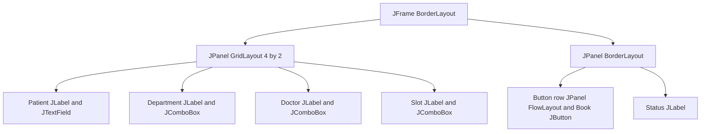

# Q2 Hospital outpatient appointment desk

## Aim and event model
Model a department-dependent doctor selection, validate an appointment and protect unfinished input when closing.

| Event source | Event object | Listener interface | Handler action |
|---|---|---|---|
| Department JComboBox | ActionEvent | ActionListener | Refresh doctors from selected department; mark dirty |
| Doctor / slot JComboBox | ActionEvent | ActionListener | Mark unfinished form dirty |
| Patient document | DocumentEvent | DocumentListener | Mark inserted/deleted input dirty |
| Book JButton | ActionEvent | ActionListener | Validate and reserve doctor/slot, show result |
| JFrame open/activate/deactivate/close | WindowEvent | WindowListener via WindowAdapter | Trace lifecycle and handle close confirmation |
| Confirmation dialog buttons | ActionEvent handled by JOptionPane | Internal dialog listeners | YES discards input; NO retains window |

## Component hierarchy

The small supplied desk uses an in-memory doctor map and an in-memory slot set for today's clinic only. It is not a persistent, multi-receptionist appointment system. A future JDBC service must use a database unique constraint for doctor/date/slot and move its calls to a worker.

## Handler pseudocode
Inputs and outputs are stated explicitly; BEGIN/END, IF/ELSE and FOR delimit structured operations.

```text
ALGORITHM REFRESH_DOCTORS
INPUT selectedDepartment, doctorsByDepartment
OUTPUT doctorSelector contains only matching doctors
BEGIN
    CLEAR doctorSelector
    FOR EACH doctor IN doctorsByDepartment[selectedDepartment] DO
        ADD doctor TO doctorSelector
    END FOR
    SET doctorSelector enabled TO (number of doctors > 0)
END

ALGORITHM BOOK_APPOINTMENT
INPUT patientId, selectedDoctor, selectedSlot, occupiedSlots
OUTPUT confirmation or validation/conflict message
BEGIN
    IF booking is busy THEN RETURN END IF
    IF patientId does not match P followed by four digits THEN
        DISPLAY patient error
        RETURN
    END IF
    IF no doctor is selected THEN DISPLAY doctor error; RETURN END IF
    SET key TO (selectedDoctor, selectedSlot)
    IF key exists in occupiedSlots THEN
        DISPLAY slot conflict
        RETURN
    END IF
    ADD key TO occupiedSlots
    SET unfinishedInput TO FALSE
    DISPLAY confirmation including patient, doctor and slot
END
```

## Trace and applet comparison
main → invokeLater → constructor → build controls → register listeners → initial doctor refresh → setVisible → windowOpened / windowActivated → department ActionListener → refreshDoctors → Book ActionListener → validate → reserve → status update → windowClosing → confirmation dialog → NO keeps window → later dispose → windowClosed. Actual activation/deactivation events vary with focus and the dialog; they are recorded in results/execution.txt rather than asserted in one universal order.

Historical applets call init once, start when becoming active, paint when needed, stop when becoming inactive and destroy when unloaded. A desktop Frame receives window events instead; paint is repeatable, not a once-only lifecycle step. This Java 21 assignment demonstrates a desktop window rather than a browser applet.

## Alternative and complexity
Caching d departments containing m total doctors costs O(d+m) references and initial O(d+m) loading; hash-map department lookup is expected O(1), followed by O(m_i) work to populate the selected department's m_i doctors. If every department contains m doctors, replace total m by d*m. A per-change parameterized JDBC query can use `WHERE department_id=?`; with a suitable index its server work is approximately O(log m + m_i), plus network latency and O(m_i) transfer/display work. Without an index it can scan O(m). Client memory falls to O(d+m_i) if only current doctors are retained; the server still stores all doctors. Query in SwingWorker and use request sequence IDs to discard stale responses after fast selection changes. Caching is fast but may become stale; querying gives fresher data at a latency cost.

## Evidence and execution

`results/compiler.txt` records actual compilation. `results/gui-tests.txt` records assertions against running desktop windows. Screenshots are real screen captures and their filenames identify the requirement demonstrated. Tests were executed in the workspace; personally rerun every required task and understand the design before submission.

## Database-on-change alternative pseudocode

```text
ALGORITHM REFRESH_DOCTORS_FROM_DATABASE
INPUT selectedDepartment, latestRequestNumber
OUTPUT current department's doctor list or visible error
BEGIN
    INCREMENT latestRequestNumber
    CAPTURE requestNumber and selectedDepartment
    DISABLE doctor selector
    START background worker
        OPEN connection and prepared statement
        SELECT id, name FROM doctors WHERE department_id = ? ORDER BY name
        BIND selectedDepartment; EXECUTE query; COLLECT matching doctors
        CLOSE result set, statement and connection
    ON completion on EDT
        IF requestNumber differs from latestRequestNumber THEN RETURN END IF
        IF worker failed THEN DISPLAY error ELSE REPLACE doctor list END IF
        ENABLE selector when at least one doctor is available
END
```
