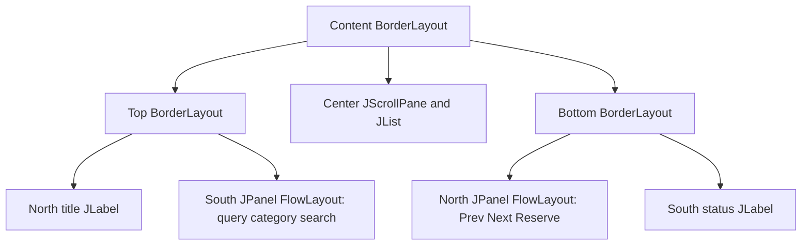

# Q3 Campus library search and layout

## Aim and layout choices
Build a usable search, result and pagination screen whose result area absorbs resizing.

| Container | Layout | Reason |
|---|---|---|
| Main content | BorderLayout | NORTH and SOUTH stay at preferred height; CENTER expands |
| Top group | BorderLayout | Heading above search controls |
| Search row | FlowLayout LEFT | Controls retain preferred component sizes |
| Bottom group | BorderLayout | Buttons above persistent status |
| Navigation row | FlowLayout LEFT | Prev, Next and Reserve retain preferred sizes |
| Result region | JScrollPane around JList | Center fills remaining space and handles overflow |

GridLayout would force equal cells and stretch all regions; it suits Q2's compact label/field form instead. CardLayout is useful for replacing entire screens, as in Q6, and does not by itself satisfy this screen's simultaneous regions. The minimum frame size is 650 by 350 to keep the search row from wrapping at the three tested sizes. Below the supported width, FlowLayout may wrap and a fixed preferred NORTH height can clip controls; use a responsive layout or larger minimum width for narrower devices.

## Nested structure

The program searches 24 local sample books, filters by category, paginates six results and reserves the selected title with visible feedback. It is a GUI/layout exercise rather than a persistent reservation backend.

## Resize experiment
Screenshots size-650x350.png, size-850x550.png and size-1100x750.png are actual Robot screen captures after setSize, validation and repaint. Exact measured region heights are recorded in results/gui-tests.txt. The results region gains exactly the frame's height increase, while both control rows keep their measured height. reserved.png links category filtering and selection to a reservation status message.

## Alternatives and complexity
GridBagLayout can place the same regions in one named layout container: search controls have weighty=0, results have weightx=weighty=1 and fill=BOTH, buttons/status have weighty=0. It needs more constraints but can remove the two grouping panels and two row panels. The current design has five named layout containers including the root content pane; scroll-pane internal containers are common to both counts.

Nested BorderLayout and FlowLayout visit N immediate children across the tree in O(N) ordinary layout work; each BorderLayout has at most five region children. For GridBagLayout, preferred-size collection, grid-track calculation and constraint resolution add work depending on children and grid dimensions; an uncomplicated fixed-row design is approximately linear in N, but a universal O(N) bound for arbitrary spanning constraints is not claimed. Both retain O(N) component/constraint state; nesting adds O(C) container objects. Absolute positioning can use one container and O(N) setBounds operations for each explicit resize, with O(N) rectangles. Without a resize handler those rectangles remain fixed and results fail to grow. It is fragile under font, DPI, localization and platform changes. One layout call does not imply constant CPU work.

## Evidence and execution

`results/compiler.txt` records actual compilation. `results/gui-tests.txt` records assertions against running desktop windows. Screenshots are real screen captures and their filenames identify the requirement demonstrated. Tests were executed in the workspace; personally rerun every required task and understand the design before submission.
