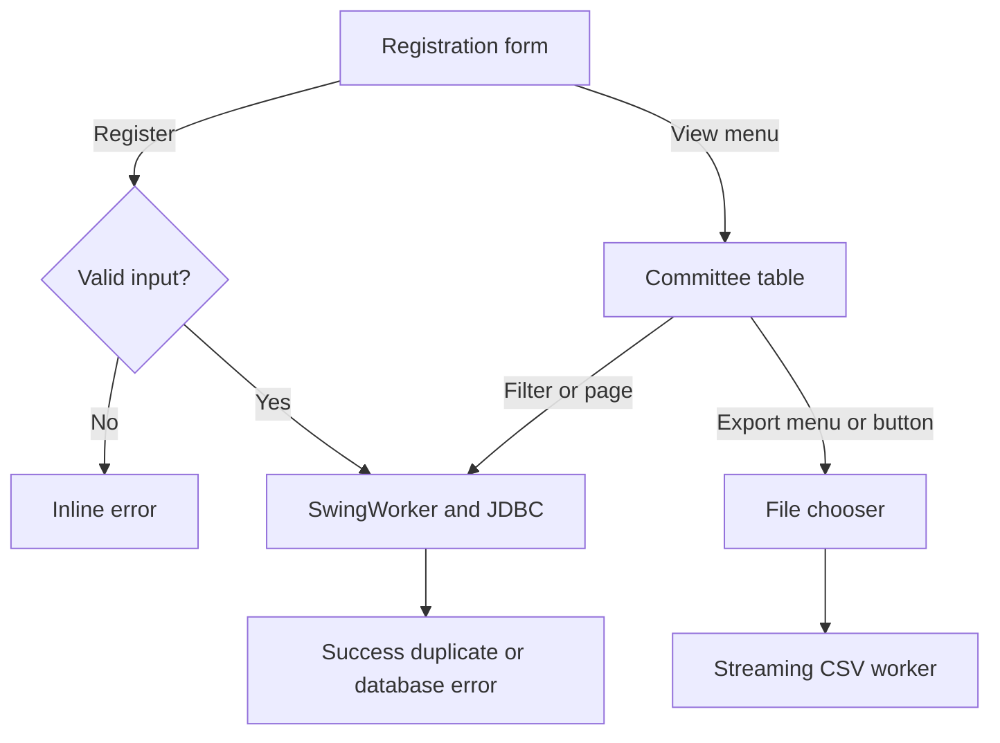
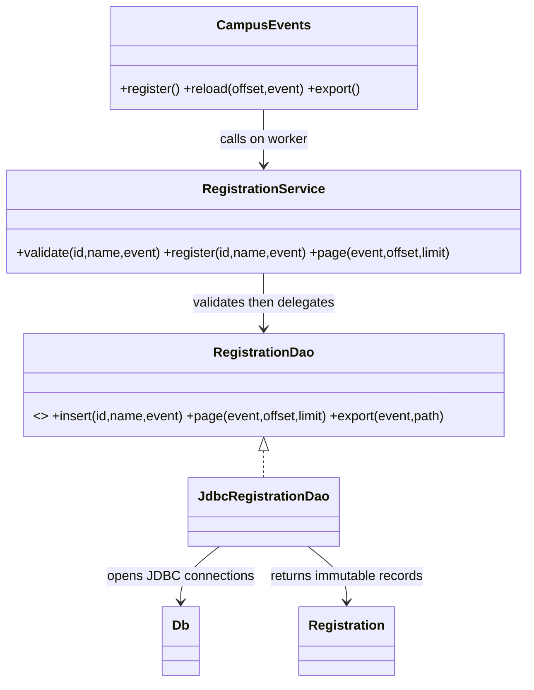

# Q6 Campus event registration

## Requirements and users
Students enter registration details; committee users view/filter/export registrations. The desktop has a registration form and committee table switched by a View menu, and a File menu for export/exit. This assignment demonstration has no authentication; it does not enforce production committee access restrictions.

| Testable requirement | Design and check |
|---|---|
| Reject invalid ID/name/event | Service validation before persistence; visible input message |
| Store a normal registration | Prepared INSERT and successful confirmation |
| One student/event pair at most once | Database UNIQUE(student_id,event_id), including concurrent submissions |
| Keep loading responsive | SwingWorker owns JDBC work; EDT timer advances during injected 1200 ms latency |
| Filter by event | Parameterized event predicate; selected result shown in JTable |
| Bound a displayed page | LIMIT 51 (50 rows plus next-page sentinel) and OFFSET |
| Export selected event | Forward-only Connector/J streaming result, escaped CSV, worker file writing |
| Close resources | try-with-resources for every connection, statement, result set and writer |
| Recover from database failure | Error status, controls restored, exception logged |

## Screens and event flow

A background operation disables new submissions, filter/page changes and export until its result is applied. Captured input belongs to one request; handlers do not read Swing widgets from doInBackground. A form may still be edited while registration runs, but the in-flight operation uses the captured original values. Closing is deferred until that operation finishes, so the UI does not imply cancellation of a commit already in progress.

## Layered class design

The schema holds events and registrations with an event foreign key and unique student/event index. Duplicate checking is authoritative inside MySQL; a pre-insert SELECT alone would race. Error code 1062 becomes a user-facing duplicate message, while other SQL failures stay errors. PreparedStatement binds strings without SQL concatenation. Export uses a temporary file and replaces the destination only after successful streaming; it does not claim universal crash-atomic publication.

## Handler pseudocode
```text
ALGORITHM REGISTER
INPUT studentId, studentName, selectedEvent
OUTPUT success, duplicate message or error
BEGIN
    IF another operation is active THEN RETURN END IF
    VALIDATE trimmed values
    IF invalid THEN DISPLAY reason; RETURN END IF
    CAPTURE values; DISABLE operation controls
    START background worker
        TRY INSERT using bound parameters and a fresh connection
        IF duplicate-key error THEN RETURN duplicate message END IF
        PROPAGATE other SQL errors
    ON worker completion on EDT
        DISPLAY result or error
        ENABLE operation controls
END

ALGORITHM FILTER
INPUT selectedEvent, requestedOffset
OUTPUT at most 50 table rows and navigation state
BEGIN
    IF another operation is active THEN RETURN END IF
    CAPTURE selectedEvent and requestedOffset
    DISABLE operation controls; DISPLAY loading status
    START background worker
        QUERY ordered rows using optional event predicate
        APPLY LIMIT 51 OFFSET requestedOffset
        RETURN rows; CLOSE JDBC resources
    ON worker completion on EDT
        SET hasNext TO (row count > 50)
        REPLACE table with first 50 rows
        UPDATE offset and button states
        DISPLAY page status or query error
END
```

## Demonstration and latency
Actual MySQL version, driver, compile commands and GUI test logs are retained. invalid.png shows rejected input; normal.png shows a committed registration; duplicate.png shows the same student/event rejected; filter.png shows persisted Music rows. A second two-thread service test submits one new student/event pair concurrently and requires one insertion and one duplicate. The artificial 1200 ms test latency is in the DAO on its worker thread and is off by default. The EDT tick count advances during that wait. The CSV in results/registrations.csv is an actual filtered export, not mock output.

## Loading 100000 registrations: alternative and complexity
A separate benchmark_registrations table contains exactly 100000 synthetic rows so benchmarks do not flood the live demonstration table. The benchmark selects equivalent registration columns, performs one warmup and five timed runs for all rows, the first page and a late OFFSET page. Raw nanoseconds, retained row counts and retained string-character counts are saved in loading-measurements.csv. String characters are a payload metric, not heap-byte measurements; object headers, compact strings, driver buffering and table cells add memory.

Loading every row transfers/materializes O(N) rows and retains O(N) model records; rebuilding JTable models is still EDT work and should not be a huge done() callback. The page design retains O(P) rows in its table (P=50, plus a sentinel), with an indexed ordered query taking approximately O(log N + offset + P) row traversal in an offset plan. A late OFFSET may scan nearly N entries; LIMIT does not make every query O(P). Repeatedly visiting every page with OFFSET can sum to quadratic traversal, whereas keyset pagination using `WHERE id > lastSeenId ORDER BY id LIMIT ?` avoids that growing skip cost. Server/index state remains O(N) in both designs. All-row selection can offer complete client-side sorting/filtering without more requests but raises initial load and memory cost. Page selection improves first display and bounded EDT updates; it does not give global client-side sorting across unloaded pages. Keep both variants off the EDT. Streaming export uses O(1) retained row state plus driver/I/O buffers, O(N) total row work, and O(export bytes) disk storage.

## Evidence and execution

`results/compiler.txt` records actual compilation. `results/gui-tests.txt` records assertions against running desktop windows. Screenshots are real screen captures and their filenames identify the requirement demonstrated. Tests were executed in the workspace; personally rerun every required task and understand the design before submission.

## Observed loading measurements

| Approach | Mean of five runs (ms) | Retained rows | String characters |
|---|---:|---:|---:|
| all | 67.705 | 100000 | 3688890 |
| first_page | 0.522 | 51 | 1724 |
| last_page | 16.363 | 50 | 1850 |

The first page is much faster in this run, while the late OFFSET page is slower than the first. Fixed test order and a warm database/cache limit generalization. The sample is too small for universal speed claims. The 100000-row benchmark table is synthetic and separate from actual GUI registrations.

## Null-input service boundary corrected

RegistrationService now trims only non-null values and then calls its validator. Null IDs or names produce a meaningful IllegalArgumentException before the DAO is called. Focused tests also verify blank values and that valid padded values are trimmed and inserted once. See `results/edge-case-tests.txt` and `tools/EdgeCaseChecks.java`; these boundary tests use a recording DAO, while the existing MySQL GUI and concurrency evidence remains in the other result files.
